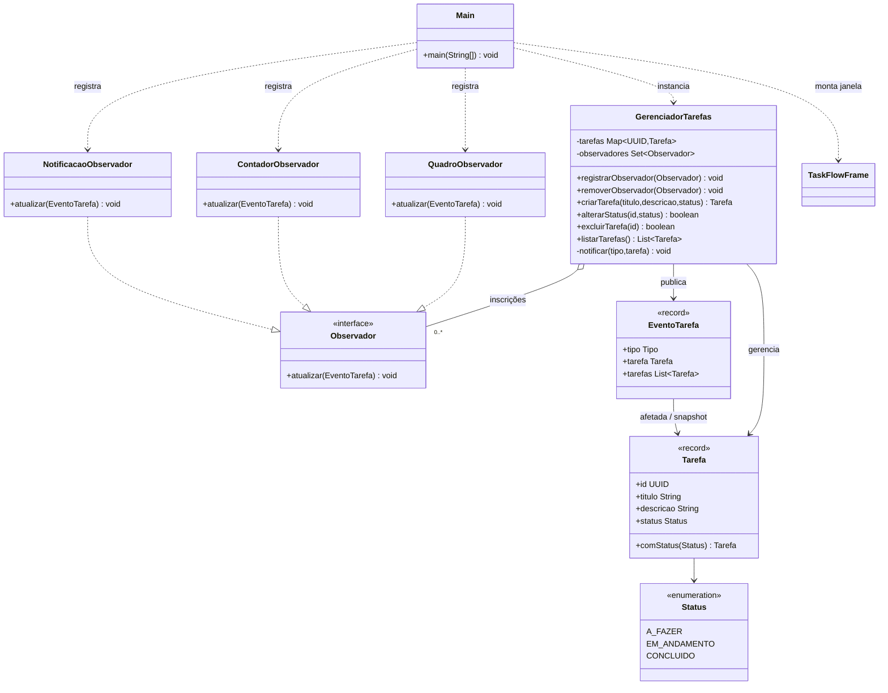

# TaskFlow — Diagrama de classes (núcleo Observer)

Diagrama simplificado dos contratos e dependências mais relevantes. Os detalhes de layout Swing foram omitidos para facilitar a apresentação.

## Leitura do diagrama

1. **Subject:** `GerenciadorTarefas` armazena os dados e gerencia uma coleção de `Observador`.
2. **Contrato:** `Observador` declara `atualizar(EventoTarefa)`; o gerenciador não depende dos observadores concretos.
3. **Evento:** `EventoTarefa` carrega tipo, tarefa afetada e snapshot imutável da lista após a alteração.
4. **Observadores concretos:** o quadro, o contador e os avisos reagem separadamente.
5. **Composição:** `Main` constrói e registra os objetos.

O diagrama é didático e focaliza o padrão Observer; não representa cada método, componente ou relação visual do projeto.
